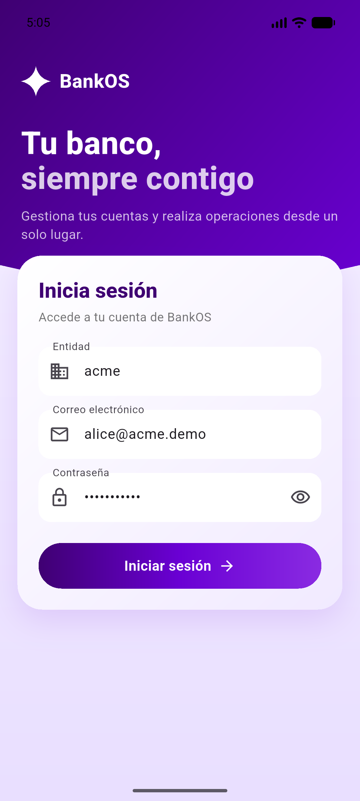
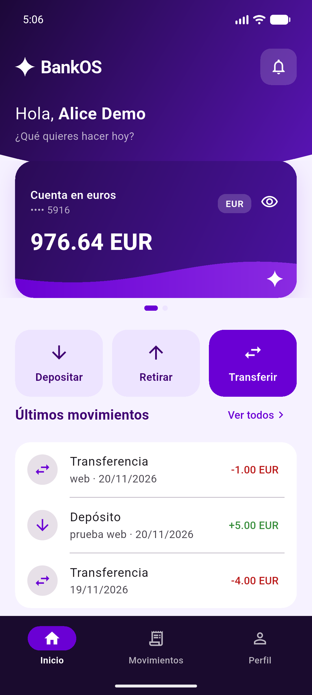
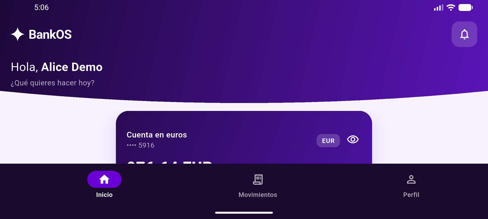
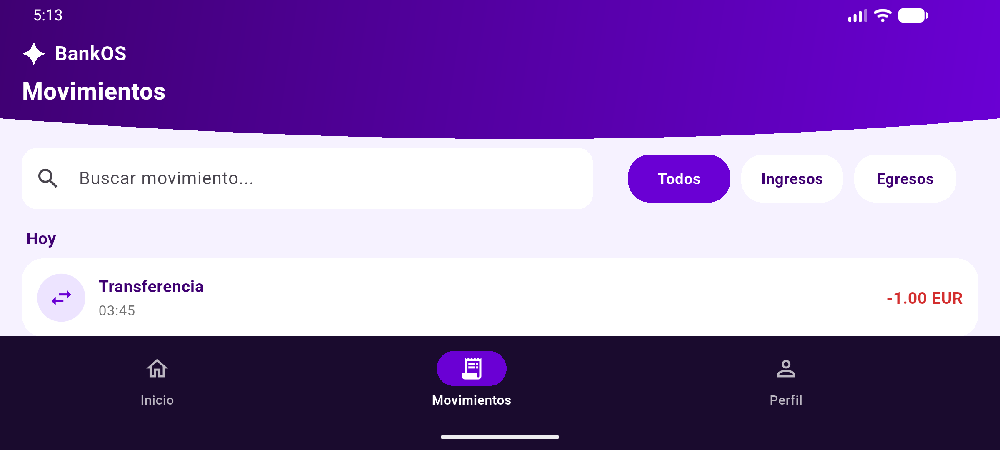
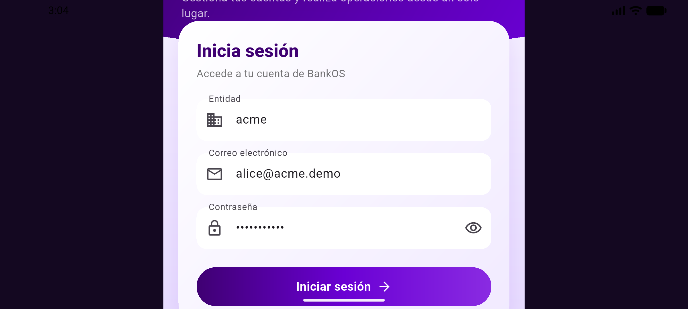

# BankOS Demo

Versión en inglés: [README.md](README.md).

Esta carpeta contiene dos frontends de prueba para la API de BankOS:

- **Web (Jinja):** una aplicación web renderizada en el servidor, con landing, login, inicio, transferencias, depósitos, retiros, movimientos y perfil.
- **Android (Flutter):** una app móvil que consume la misma API.

La demo **no modifica el backend**. Vive en `demo/` y usa la API tal como está en `app/`.

> La demo es un prototipo para pruebas. Las credenciales y los datos son ficticios y no deben usarse en producción.

---

## Estructura

```text
demo/
├── web/                 # Frontend web en Jinja
│   ├── main.py          # Punto de entrada: API + web en un solo servidor
│   ├── routes.py        # Rutas de las páginas
│   ├── auth.py          # Sesión por cookie
│   ├── presentation.py  # Filtros de formato (dinero, fechas, cuentas)
│   ├── templates/       # Plantillas HTML
│   └── static/          # Imágenes de la landing y del login
├── mobile/              # App Android en Flutter
├── docs/                # Documentación del frontend
├── tests/               # Pruebas de la demo web
├── images/              # Capturas usadas en este README
└── requirements.txt     # Dependencias extra de la demo (Jinja y multipart)
```

---

## Requisitos

- Python 3.12 o superior.
- Flutter 3.x y Android Studio, solo si vas a correr la app móvil.
- Un emulador de Android o un teléfono con depuración USB.

---

## 1. Preparar el backend y los datos de prueba

Desde la raíz del repositorio (`BankOS-completo/`):

```powershell
python -m pip install -r requirements.txt
python -m pip install -r demo/requirements.txt
python -m scripts.seed_demo
```

El comando `scripts.seed_demo` es idempotente: puedes correrlo varias veces sin duplicar datos. Crea la entidad `acme` con sus usuarios y cuentas de prueba.

---

## 2. Levantar el servidor (web + API)

Desde la raíz del repositorio:

```powershell
python -m uvicorn demo.web.main:app --port 8000
```

Con ese único servidor quedan disponibles:

| Qué | Dónde |
|---|---|
| Landing de la web | http://localhost:8000/ |
| Login web | http://localhost:8000/login |
| API REST | http://localhost:8000/api/v1 |
| Documentación de la API | http://localhost:8000/docs |

El servidor de la demo incluye toda la API de BankOS, así que la app móvil y la web usan el mismo puerto.

### Credenciales de prueba

| Campo | Valor |
|---|---|
| Entidad | `acme` |
| Correo | `alice@acme.demo` |
| Contraseña | `DemoPass123` |

### Iniciar sesión en la web

1. Abre http://localhost:8000/login.
2. Escribe la entidad, el correo y la contraseña de la tabla anterior.
3. Verás el inicio con tus cuentas, tus últimos movimientos y las operaciones rápidas.

---

## 3. Correr la app Android (Flutter)

Primero levanta el servidor del paso 2. Después, en otra terminal:

```powershell
cd demo\mobile
flutter pub get
flutter run
```

La app usa la URL `http://10.0.2.2:8000/api/v1` cuando corre en el emulador de Android. Ese es el alias del emulador para el `localhost` de tu computadora.

Si necesitas otra URL (por ejemplo, un teléfono real en tu red), compila con esta opción:

```powershell
flutter run --dart-define=API_BASE_URL=http://TU_IP:8000/api/v1
```

### Capturas de la app Android

**Login (vertical)**



**Inicio (vertical)**



**Inicio (horizontal)**



**Movimientos (horizontal)**



**Login (horizontal)**



---

## 4. Pruebas

Desde la raíz del repositorio:

```powershell
python -m pytest tests demo/tests
```

- `tests/`: pruebas del backend.
- `demo/tests/`: pruebas de la demo web.

Para las pruebas de Flutter:

```powershell
cd demo\mobile
flutter test
```

---

## Notas

- La sesión web usa una cookie HTTP-only llamada `bankos_session`.
- La landing es la página pública de `/`. Cuando inicias sesión, esa misma ruta muestra el inicio.
- En el inicio web y en las tarjetas de saldo de la app, el número de cuenta aparece enmascarado y solo se ven los últimos cuatro dígitos. Los selectores de transferencia todavía muestran el número completo.
- La demo está pensada para ejecutarse en local. No la expongas a internet sin revisar la configuración.
