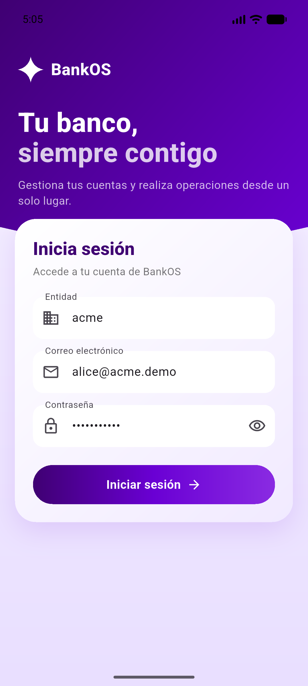
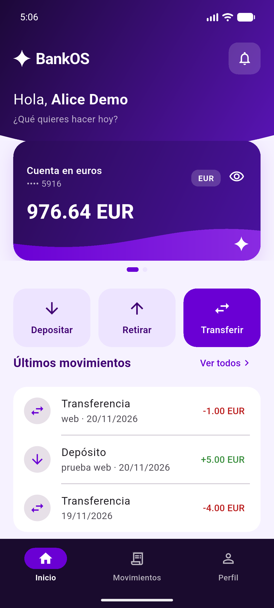
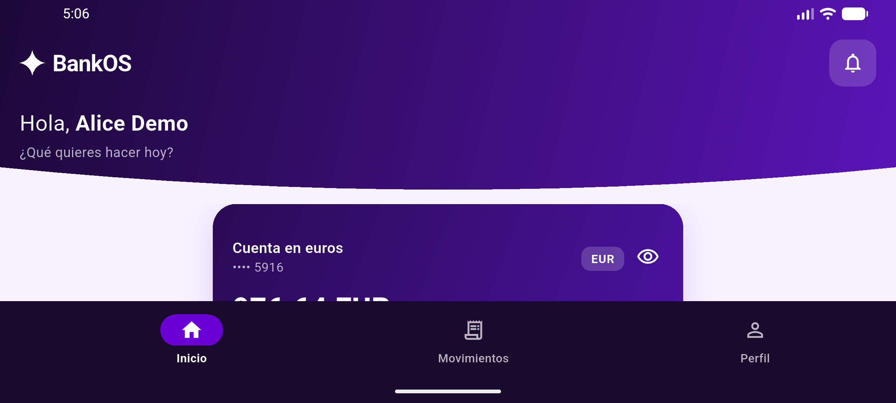
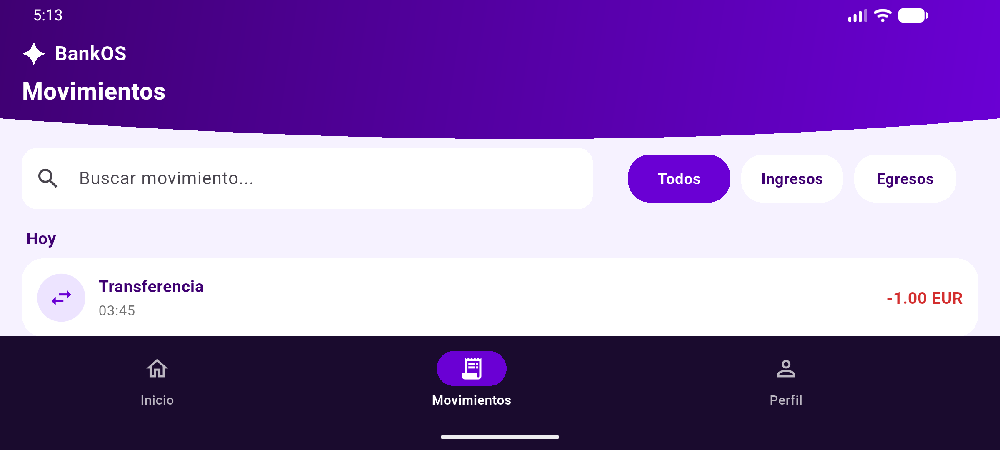
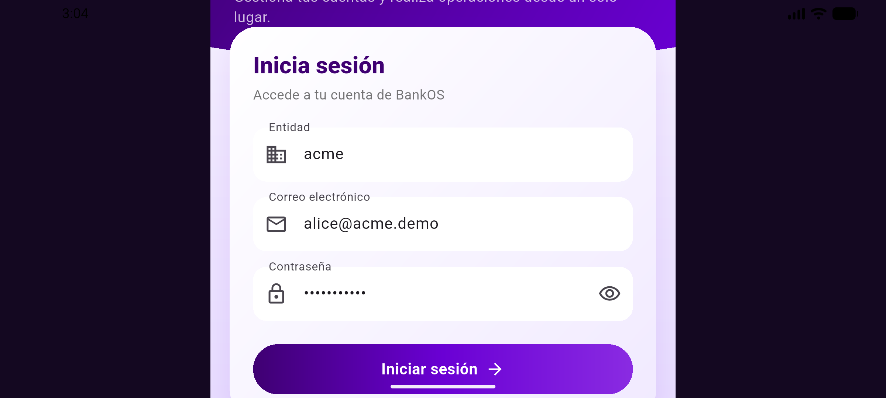

# BankOS Demo

This folder contains two test frontends for the BankOS API:

- **Web (Jinja):** a server-rendered web app with a landing page, login, home, transfers, deposits, withdrawals, transactions and profile.
- **Android (Flutter):** a mobile app that consumes the same API.

The demo **does not modify the backend**. It lives in `demo/` and uses the API as it is in `app/`.

> The demo is a prototype for testing. The credentials and data are fictional and must not be used in production.

Spanish version: [README.es.md](README.es.md).

---

## Structure

```text
demo/
├── web/                 # Jinja web frontend
│   ├── main.py          # Entrypoint: API + web in one server
│   ├── routes.py        # Page routes
│   ├── auth.py          # Cookie-based session
│   ├── presentation.py  # Display filters (money, dates, accounts)
│   ├── templates/       # HTML templates
│   └── static/          # Landing and login images
├── mobile/              # Flutter Android app
├── docs/                # Frontend documentation
├── tests/               # Demo web tests
├── images/              # Screenshots used in this README
└── requirements.txt     # Extra demo dependencies (Jinja and multipart)
```

---

## Requirements

- Python 3.12 or later.
- Flutter 3.x and Android Studio, only if you run the mobile app.
- An Android emulator or a phone with USB debugging enabled.

---

## 1. Prepare the backend and the test data

From the repository root (`BankOS-completo/`):

```powershell
python -m pip install -r requirements.txt
python -m pip install -r demo/requirements.txt
python -m scripts.seed_demo
```

`scripts.seed_demo` is idempotent: you can run it several times without duplicating data. It creates the `acme` tenant with its test users and accounts.

---

## 2. Start the server (web + API)

From the repository root:

```powershell
python -m uvicorn demo.web.main:app --port 8000
```

This single server provides:

| What | Where |
|---|---|
| Web landing page | http://localhost:8000/ |
| Web login | http://localhost:8000/login |
| REST API | http://localhost:8000/api/v1 |
| API documentation | http://localhost:8000/docs |

The demo server includes the whole BankOS API, so the mobile app and the web use the same port.

### Test credentials

| Field | Value |
|---|---|
| Tenant | `acme` |
| Email | `alice@acme.demo` |
| Password | `DemoPass123` |

### Sign in on the web

1. Open http://localhost:8000/login.
2. Enter the tenant, email and password from the table above.
3. You will see the home page with your accounts, recent transactions and quick actions.

---

## 3. Run the Android app (Flutter)

Start the server from step 2 first. Then, in another terminal:

```powershell
cd demo\mobile
flutter pub get
flutter run
```

When it runs on the Android emulator, the app uses `http://10.0.2.2:8000/api/v1`. That is the emulator's alias for your computer's `localhost`.

If you need another URL (for example, a real phone on your network), build with this option:

```powershell
flutter run --dart-define=API_BASE_URL=http://YOUR_IP:8000/api/v1
```

### Android screenshots

**Login (portrait)**



**Home (portrait)**



**Home (landscape)**



**Transactions (landscape)**



**Login (landscape)**



---

## 4. Tests

From the repository root:

```powershell
python -m pytest tests demo/tests
```

- `tests/`: backend tests.
- `demo/tests/`: demo web tests.

For the Flutter tests:

```powershell
cd demo\mobile
flutter test
```

---

## Notes

- The web session uses an HTTP-only cookie named `bankos_session`.
- The landing page is the public `/` route. After you sign in, the same route shows the home page.
- On the web home and in the app's balance cards, account numbers are masked and only the last four digits are shown. The transfer selectors still show the full number.
- The demo is meant to run locally. Review the configuration before exposing it to the internet.
