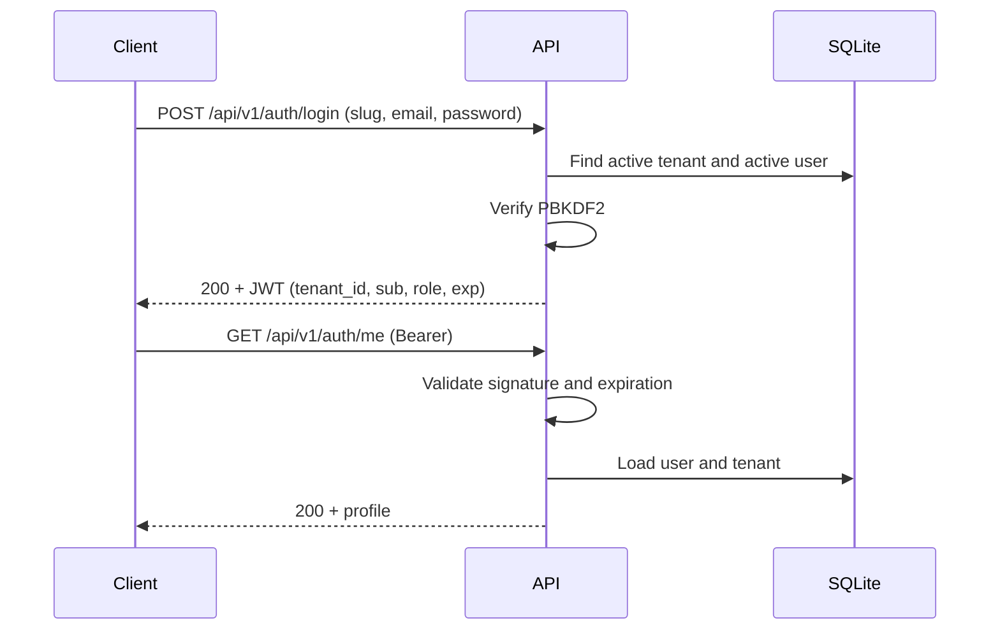

# Authentication

Users belong to a tenant and can only authenticate inside it. Login requires the tenant slug, the email and the password.

## Log in

```bash
curl -X POST http://127.0.0.1:8000/api/v1/auth/login \
  -H "Content-Type: application/json" \
  -d '{
    "tenant_slug": "acme",
    "email": "admin@acme.demo",
    "password": "DemoPass123"
  }'
```

`200` response:

```json
{
  "success": true,
  "code": "LOGIN_SUCCESS",
  "message": "Authenticated",
  "data": {
    "access_token": "eyJhbGciOiJIUzI1NiIsInR5cCI6IkpXVCJ9...",
    "token_type": "bearer",
    "expires_in": 3600,
    "user": {
      "id": "9a7b6c5d-4e3f-2a1b-0c9d-8e7f6a5b4c3d",
      "email": "admin@acme.demo",
      "full_name": "Demo Administrator",
      "role": "administrator",
      "is_active": true,
      "created_at": "2026-11-12T10:00:00Z"
    }
  },
  "correlation_id": "8f14e45f-ea0c-4b1f-9d5f-1c2a3b4c5d6e"
}
```

The same email can exist in different tenants; the `tenant_slug` + `email` pair identifies the user.

## Use the token

Every protected route expects the token in the `Authorization` header:

```bash
curl http://127.0.0.1:8000/api/v1/auth/me \
  -H "Authorization: Bearer $TOKEN"
```

`200` response:

```json
{
  "success": true,
  "code": "USER_PROFILE",
  "message": "OK",
  "data": {
    "id": "9a7b6c5d-4e3f-2a1b-0c9d-8e7f6a5b4c3d",
    "email": "admin@acme.demo",
    "full_name": "Demo Administrator",
    "role": "administrator",
    "is_active": true,
    "created_at": "2026-11-12T10:00:00Z"
  },
  "correlation_id": "8f14e45f-ea0c-4b1f-9d5f-1c2a3b4c5d6e"
}
```

## JWT claims

The token is signed with HS256 and contains these claims:

| Claim | Content |
| --- | --- |
| `sub` | User UUID. |
| `tenant_id` | UUID of the tenant the user belongs to. |
| `role` | `administrator` or `client`. |
| `email` | User email. |
| `type` | Always `access`. |
| `iat` | Issue time, in Unix seconds. |
| `exp` | Expiration time, in Unix seconds. |

The API validates the signature, the expiration and the presence of `sub`, `tenant_id`, `role` and `exp`. It then loads the user and tenant from the database and checks that both are still active. A valid token for a deactivated user stops working.

## Roles

| Role | Permissions |
| --- | --- |
| `administrator` | Register users, open accounts, change account states, update tenant configuration, read the audit log and operate on any account of the tenant. |
| `client` | Read and operate only on their own accounts. |

A client who tries to read a resource of another user in the same tenant receives `404 NOT_FOUND`. An administrator of another tenant also receives `404` for foreign resources.

## Passwords

Passwords are stored with PBKDF2-HMAC-SHA256, 260,000 iterations and a random salt per user. bcrypt, argon2 and external dependencies are not used. Passwords are never returned by the API and are never written to logs.

## Rate limits

- Login is limited per IP: `RATE_LIMIT_AUTH_PER_MINUTE`, 10 per minute by default.
- Financial operations are limited per user and tenant: `RATE_LIMIT_FINANCIAL_PER_MINUTE`, 30 per minute by default.
- Every `/api/v1` route also has a global per-IP limit: `RATE_LIMIT_IP_PER_MINUTE`, 120 per minute by default.

When a limit is exceeded, the API responds `429 RATE_LIMIT_EXCEEDED` with a `Retry-After` header.

## Authentication flow



## Current limitations

- There are no refresh tokens and no session revocation: the token is valid until it expires.
- There is no password change endpoint.
- Rate limits live in memory and are only correct with one worker.
