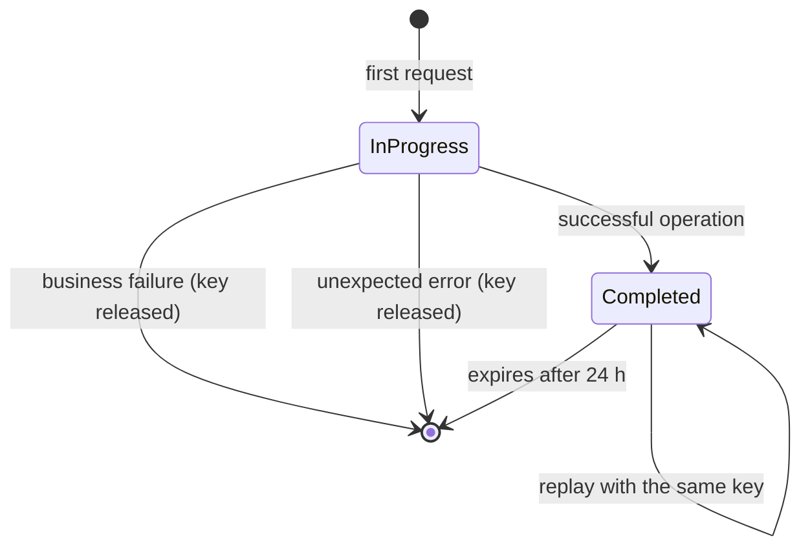

# Idempotency

Every mutable financial operation —deposits, withdrawals and transfers— requires the `Idempotency-Key` header. The key allows retrying a request without executing the movement twice.

## Contract

- The header is mandatory.
- It must be a valid UUID.
- It is normalized to its canonical representation.
- It is strictly scoped to `tenant_id` + `user_id` + key.
- It expires after 24 hours.
- It applies to `POST /accounts/{id}/deposits`, `POST /accounts/{id}/withdrawals` and `POST /transfers`.

If the header is missing:

```json
{
  "success": false,
  "code": "MISSING_IDEMPOTENCY_KEY",
  "message": "The Idempotency-Key header is required",
  "details": {"header": "Idempotency-Key"},
  "correlation_id": "8f14e45f-ea0c-4b1f-9d5f-1c2a3b4c5d6e"
}
```

If it is not a UUID:

```json
{
  "success": false,
  "code": "INVALID_IDEMPOTENCY_KEY",
  "message": "The Idempotency-Key header must be a UUID",
  "details": {"header": "Idempotency-Key"},
  "correlation_id": "8f14e45f-ea0c-4b1f-9d5f-1c2a3b4c5d6e"
}
```

Both cases respond `422`.

## Replay of a completed operation

If the key was already processed successfully, the API returns exactly the same body and the original status code, without moving funds again. The response includes:

```http
X-Idempotent-Replayed: true
```

The new request body is ignored: the body stored during the first execution is returned.

```bash
# First execution
curl -X POST http://127.0.0.1:8000/api/v1/transfers \
  -H "Authorization: Bearer $TOKEN" \
  -H "Idempotency-Key: 7d444840-9dc0-11d1-b245-5ffdce74fad2" \
  -H "Content-Type: application/json" \
  -d '{"source_account_id":"...","target_account_number":"731901614963","amount":"100.00"}'

# Retry with the same key
curl -X POST http://127.0.0.1:8000/api/v1/transfers \
  -H "Authorization: Bearer $TOKEN" \
  -H "Idempotency-Key: 7d444840-9dc0-11d1-b245-5ffdce74fad2" \
  -H "Content-Type: application/json" \
  -d '{"source_account_id":"...","target_account_number":"731901614963","amount":"100.00"}'
```

The second response has the same `data.id` and the same `201` status.

## Operation in progress

If another request with the same key is running, the API responds immediately:

```json
{
  "success": false,
  "code": "IDEMPOTENCY_IN_PROGRESS",
  "message": "A transaction with this Idempotency-Key is already in progress",
  "details": null,
  "correlation_id": "8f14e45f-ea0c-4b1f-9d5f-1c2a3b4c5d6e"
}
```

The HTTP status is `409 Conflict`. The financial movement is not executed.

## Business failure

If the operation fails a business rule, for example due to insufficient funds:

1. The movement is rolled back.
2. A transaction with `status: "error"` and `error_code` is persisted.
3. The idempotency record is deleted to release the key.
4. The business error is returned.

After fixing the cause —for example, by depositing funds— the retry with the same key runs normally.

```json
{
  "success": false,
  "code": "INSUFFICIENT_FUNDS",
  "message": "The source account does not have enough funds to cover the amount and fee",
  "details": {
    "balance": "0.00",
    "amount": "100.00",
    "fee": "2.00",
    "required": "102.00",
    "currency": "USD"
  },
  "correlation_id": "8f14e45f-ea0c-4b1f-9d5f-1c2a3b4c5d6e"
}
```

## Unexpected failure

If an uncontrolled error occurs, the transaction is rolled back and the key is released so the caller can retry. No `error` transaction is persisted in that case.

## State diagram



## Persistence and concurrency

The idempotency record is stored in the `idempotency_keys` table with status `in_progress` or `completed`, the response status code and the original body. The database enforces the uniqueness of `tenant_id` + `user_id` + `key`. An in-memory lock per key serializes concurrent requests inside the process.

## Multi-worker limitation

The in-memory lock only protects one process. The database unique constraint still prevents duplicates, but concurrency behaviour and rate limits are designed for **one worker**. If you deploy several workers, move the lock and rate limiting to a shared store. See [Deployment](deployment.md).
