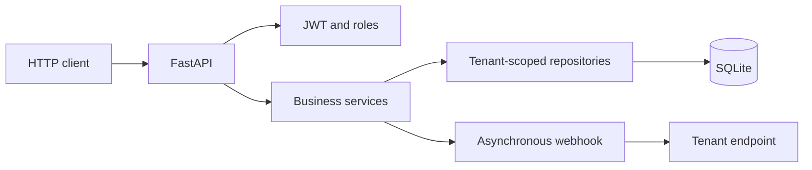

# BankOS

BankOS is a multi-tenant banking platform as a service. Every financial institution runs as an independent tenant with its own users, accounts, currencies, commissions, exchange rates, business rules and audit records.

This repository contains **only the backend**: a REST API built with FastAPI, SQLAlchemy and SQLite. The frontend and the mobile application are developed separately and are not part of this project.

## Main capabilities

- Strict tenant isolation: the `tenant_id` travels in the JWT and every repository filters by it.
- `administrator` and `client` roles with different permissions.
- Bank accounts with soft delete and blocked operations on inactive accounts.
- Deposits, withdrawals and internal transfers with configurable commission.
- Multi-currency transfers with a static rate table per tenant.
- Mandatory idempotency on every mutable financial operation.
- Paginated transaction history with filters.
- Immutable audit of administrative actions.
- Asynchronous webhooks for received transfers.
- Standard response envelopes, `/api/v1` versioning and `X-Correlation-ID` tracing.

## High-level architecture

## Where to start

| If you want to | Read |
| --- | --- |
| Run BankOS on your machine | [Getting started](getting-started.md) |
| Learn the environment variables and tenant settings | [Configuration](configuration.md) |
| Understand login, tokens and roles | [Authentication](authentication.md) |
| See how each institution is isolated | [Multi-tenancy](multi-tenancy.md) |
| Manage bank accounts | [Accounts](accounts.md) |
| Operate deposits, withdrawals and history | [Operations](operations.md) |
| Understand the idempotency contract | [Idempotency](idempotency.md) |
| Calculate commissions and conversions | [Transfers and rates](transfers.md) |
| Review the audit log | [Audit](audit.md) |
| Configure HTTP notifications | [Webhooks](webhooks.md) |
| Look up error codes and envelopes | [Errors](errors.md) |
| Deploy with Docker | [Deployment](deployment.md) |

## Spanish documentation

The documentation is also available in Spanish. Use the language selector of the site.
