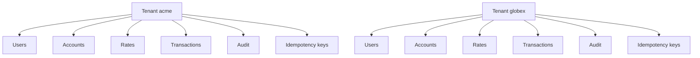

# Multi-tenancy

BankOS is a multi-tenant platform: every financial institution is a tenant with independent data and configuration. Isolation is logical and enforced in the repository layer.

## Register a tenant

Registration is public. It creates the tenant and its first administrator in a single transaction.

```bash
curl -X POST http://127.0.0.1:8000/api/v1/tenants \
  -H "Content-Type: application/json" \
  -d '{
    "name": "Acme Demo Bank",
    "slug": "acme",
    "admin_email": "admin@acme.demo",
    "admin_full_name": "Demo Administrator",
    "admin_password": "DemoPass123",
    "base_currency": "USD",
    "max_transaction_amount": "1000000.00",
    "commission_type": "percentage",
    "commission_value": "2"
  }'
```

`201` response:

```json
{
  "success": true,
  "code": "TENANT_REGISTERED",
  "message": "Tenant created",
  "data": {
    "tenant": {
      "id": "4f3f0f0e-6d1a-4b5e-9f4e-2f5a1c7d8e90",
      "name": "Acme Demo Bank",
      "slug": "acme",
      "base_currency": "USD",
      "max_transaction_amount": "1000000.00",
      "commission_type": "percentage",
      "commission_value": "2.000000",
      "webhook_url": null,
      "is_active": true,
      "created_at": "2026-11-12T10:00:00Z"
    },
    "admin": {
      "id": "9a7b6c5d-4e3f-2a1b-0c9d-8e7f6a5b4c3d",
      "email": "admin@acme.demo",
      "full_name": "Demo Administrator",
      "role": "administrator",
      "is_active": true,
      "created_at": "2026-11-12T10:00:00Z"
    }
  },
  "correlation_id": "8f14e45f-ea0c-4b1f-9d5f-1c2a3b4c5d6e"
}
```

Registration does not return a token. After creating the tenant, log in with `POST /api/v1/auth/login`.

### Slug rules

- Between 3 and 60 characters.
- Lowercase letters, digits and hyphens only.
- It must start and end with a letter or digit.
- It is unique across the platform.
- If it already exists, the API responds `409 TENANT_SLUG_TAKEN`.

## Isolation model



Every business table has a `tenant_id`. Repositories receive the `tenant_id` of the authenticated principal and apply it to every query. No route accepts an arbitrary client-supplied `tenant_id`.

Consequences:

- A resource from another tenant behaves as if it does not exist: `404 NOT_FOUND`.
- An administrator cannot read or operate on resources from another tenant.
- A client only sees their own accounts and transactions.
- Idempotency keys are scoped to `tenant_id` + `user_id` + key.
- The audit log is only readable inside the token tenant.

## Roles inside the tenant

| Role | Scope |
| --- | --- |
| `administrator` | Manages users, accounts, configuration, rates, audit and operations on any account of the tenant. |
| `client` | Only reads and operates on their own accounts. |

Users are created with `POST /api/v1/users`. A client cannot list users or open accounts.

## Physical isolation

Isolation is logical: all tenants share the same SQLite database and schema. There is no physical database per tenant. This is enough for the project scope, but physical separation would require one database per tenant or an engine with row-level isolation and additional policies.

## Audit on registration

Registering a tenant creates two audit entries inside the new tenant:

- `tenant.created`
- `user.created` for the initial administrator

Later user, account and configuration changes are also recorded. See [Audit](audit.md).
