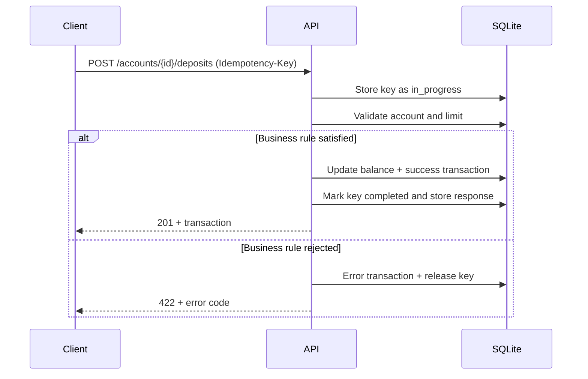

# Operations

Deposits and withdrawals are mutable operations and require `Idempotency-Key`. They run on an account visible to the caller and are stored as transactions.

## Deposit

```bash
curl -X POST http://127.0.0.1:8000/api/v1/accounts/$ACCOUNT_ID/deposits \
  -H "Authorization: Bearer $TOKEN" \
  -H "Idempotency-Key: 7d444840-9dc0-11d1-b245-5ffdce74fad2" \
  -H "Content-Type: application/json" \
  -d '{
    "amount": "1000.00",
    "description": "Initial funding"
  }'
```

`201` response:

```json
{
  "success": true,
  "code": "DEPOSIT_COMPLETED",
  "message": "Deposit completed",
  "data": {
    "id": "0f1e2d3c-4b5a-6978-8796-a5b4c3d2e1f0",
    "type": "deposit",
    "status": "success",
    "source_account_number": null,
    "target_account_number": "731901614963",
    "amount": "1000.00",
    "currency": "USD",
    "converted_amount": "1000.00",
    "target_currency": "USD",
    "exchange_rate": "1.000000",
    "fee": "0.00",
    "description": "Initial funding",
    "idempotency_key": "7d444840-9dc0-11d1-b245-5ffdce74fad2",
    "error_code": null,
    "created_at": "2026-11-12T10:10:00Z"
  },
  "correlation_id": "8f14e45f-ea0c-4b1f-9d5f-1c2a3b4c5d6e"
}
```

Rules:

- The account must be `active`.
- The amount must be strictly positive and have at most 2 decimals.
- The amount cannot exceed the tenant `max_transaction_amount`.
- An administrator can deposit into any account of the tenant; a client only into their own.
- No commission is applied to deposits.

## Withdrawal

```bash
curl -X POST http://127.0.0.1:8000/api/v1/accounts/$ACCOUNT_ID/withdrawals \
  -H "Authorization: Bearer $TOKEN" \
  -H "Idempotency-Key: 9b2d3e4f-5a6b-7c8d-9e0f-1a2b3c4d5e6f" \
  -H "Content-Type: application/json" \
  -d '{
    "amount": "50.00",
    "description": "Cash withdrawal"
  }'
```

The response uses the `WITHDRAWAL_COMPLETED` code and the same transaction schema.

Additional rules:

- The balance must cover the requested amount.
- If it does not, the API responds `422 INSUFFICIENT_FUNDS`.
- No commission is applied to withdrawals.

## Transaction history

```bash
curl "http://127.0.0.1:8000/api/v1/transactions?limit=20&offset=0&type=transfer&status=success" \
  -H "Authorization: Bearer $TOKEN"
```

Filters:

| Parameter | Values | Description |
| --- | --- | --- |
| `limit` | 1–100 | Items per page. Defaults to 50. |
| `offset` | ≥ 0 | Items to skip. |
| `type` | `deposit`, `withdrawal`, `transfer` | Operation type. |
| `status` | `success`, `error` | Operation result. |
| `account_id` | UUID | Source or target account. |
| `date_from` | ISO 8601 | Inclusive lower bound. |
| `date_to` | ISO 8601 | Inclusive upper bound. |

An administrator sees the whole tenant history. A client only sees transactions that involve one of their accounts.

Response:

```json
{
  "success": true,
  "code": "TRANSACTION_LIST",
  "message": "OK",
  "data": {
    "items": [
      {
        "id": "0f1e2d3c-4b5a-6978-8796-a5b4c3d2e1f0",
        "type": "deposit",
        "status": "success",
        "source_account_number": null,
        "target_account_number": "731901614963",
        "amount": "1000.00",
        "currency": "USD",
        "converted_amount": "1000.00",
        "target_currency": "USD",
        "exchange_rate": "1.000000",
        "fee": "0.00",
        "description": "Initial funding",
        "idempotency_key": "7d444840-9dc0-11d1-b245-5ffdce74fad2",
        "error_code": null,
        "created_at": "2026-11-12T10:10:00Z"
      }
    ],
    "total": 1,
    "limit": 20,
    "offset": 0
  },
  "correlation_id": "8f14e45f-ea0c-4b1f-9d5f-1c2a3b4c5d6e"
}
```

## Read a transaction

```bash
curl http://127.0.0.1:8000/api/v1/transactions/$TRANSACTION_ID \
  -H "Authorization: Bearer $TOKEN"
```

A client can only read transactions of their own accounts. A foreign transaction responds `404 NOT_FOUND`.

## Failed transactions

When an operation fails a business rule, the API stores a transaction with `status: "error"` and the code in `error_code`, for example `INSUFFICIENT_FUNDS`. The failed attempt appears in the history with its `type` and `idempotency_key`, but it does not move balances. The idempotency key is released to allow a retry. See [Idempotency](idempotency.md).

## Operation flow


