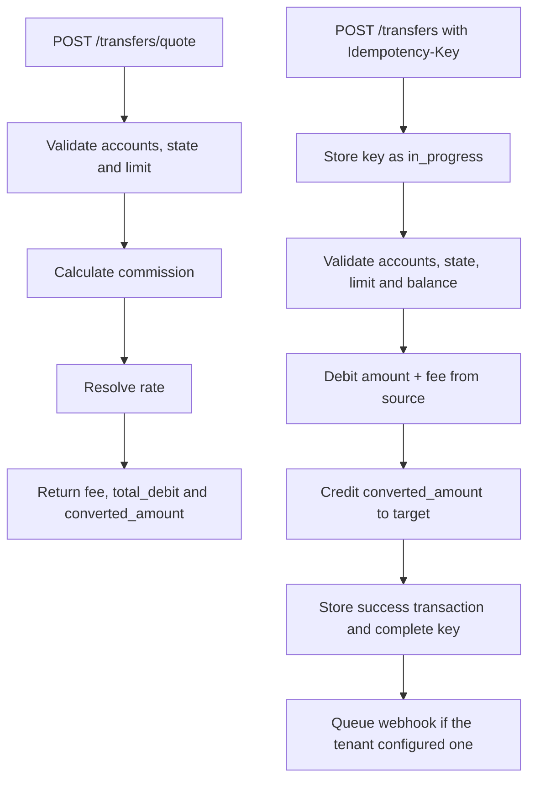

# Transfers and rates

A transfer moves funds between two accounts of the same tenant. It can use the same currency or different currencies through the tenant static rate table. The commission is charged in the source currency.

## Quote a transfer

`POST /api/v1/transfers/quote` calculates the commission, rate and amounts without moving funds. It does not require `Idempotency-Key`.

```bash
curl -X POST http://127.0.0.1:8000/api/v1/transfers/quote \
  -H "Authorization: Bearer $TOKEN" \
  -H "Content-Type: application/json" \
  -d '{
    "source_account_id": "5d4c3b2a-1f0e-9d8c-7b6a-5f4e3d2c1b0a",
    "target_account_number": "838433939096",
    "amount": "100.00"
  }'
```

`200` response:

```json
{
  "success": true,
  "code": "TRANSFER_QUOTE",
  "message": "Transfer quoted",
  "data": {
    "amount": "100.00",
    "fee": "2.00",
    "total_debit": "102.00",
    "exchange_rate": "0.900000",
    "converted_amount": "90.00",
    "source_currency": "USD",
    "target_currency": "EUR"
  },
  "correlation_id": "8f14e45f-ea0c-4b1f-9d5f-1c2a3b4c5d6e"
}
```

The quote validates that both accounts exist and are active, that they are different and that the amount does not exceed the tenant limit. **It does not check the available balance**; that is validated when the transfer is executed.

## Execute a transfer

```bash
curl -X POST http://127.0.0.1:8000/api/v1/transfers \
  -H "Authorization: Bearer $TOKEN" \
  -H "Idempotency-Key: 7d444840-9dc0-11d1-b245-5ffdce74fad2" \
  -H "Content-Type: application/json" \
  -d '{
    "source_account_id": "5d4c3b2a-1f0e-9d8c-7b6a-5f4e3d2c1b0a",
    "target_account_number": "838433939096",
    "amount": "100.00",
    "description": "Monthly transfer"
  }'
```

`201` response:

```json
{
  "success": true,
  "code": "TRANSFER_COMPLETED",
  "message": "Transfer completed",
  "data": {
    "id": "1a2b3c4d-5e6f-7a8b-9c0d-1e2f3a4b5c6d",
    "type": "transfer",
    "status": "success",
    "source_account_number": "731901614963",
    "target_account_number": "838433939096",
    "amount": "100.00",
    "currency": "USD",
    "converted_amount": "90.00",
    "target_currency": "EUR",
    "exchange_rate": "0.900000",
    "fee": "2.00",
    "description": "Monthly transfer",
    "idempotency_key": "7d444840-9dc0-11d1-b245-5ffdce74fad2",
    "error_code": null,
    "created_at": "2026-11-12T10:20:00Z"
  },
  "correlation_id": "8f14e45f-ea0c-4b1f-9d5f-1c2a3b4c5d6e"
}
```

Rules:

- Source and target must exist in the same tenant.
- Both accounts must be `active`.
- A transfer to the same account is not allowed.
- The source must have enough balance for the amount **plus the commission**.
- The amount cannot exceed `max_transaction_amount`.
- The target is identified by `account_number`, not by UUID.
- A client can only use one of their own accounts as the source; an administrator can use any account of the tenant.

## Commission

The commission is calculated on the sent amount, in the source currency:

| Type | Formula |
| --- | --- |
| `percentage` | `fee = round(amount × commission_value / 100, 2)` |
| `fixed` | `fee = commission_value` |

The total source debit is `amount + fee`. The conversion is applied to the sent amount, **not to the commission**. The target receives `round(amount × exchange_rate, 2)`.

Example with a 2 % percentage commission:

- Amount: `100.00 USD`
- Commission: `2.00 USD`
- Total debit: `102.00 USD`
- USD→EUR rate: `0.900000`
- Credited to target: `90.00 EUR`

## Exchange rates

The rate table is static and belongs to the tenant. It is fully replaced with `PUT /api/v1/tenants/me/exchange-rates`.

```bash
curl -X PUT http://127.0.0.1:8000/api/v1/tenants/me/exchange-rates \
  -H "Authorization: Bearer $ADMIN_TOKEN" \
  -H "Content-Type: application/json" \
  -d '{
    "rates": [
      {"source_currency": "USD", "target_currency": "EUR", "rate": "0.900000"},
      {"source_currency": "EUR", "target_currency": "USD", "rate": "1.100000"}
    ]
  }'
```

Rate resolution:

1. If source and target share the same currency, `1.000000` is used.
2. If the direct rate `source → target` exists, it is used.
3. Otherwise, the inverse `1 / rate(target → source)` is used, rounded to 6 decimals.
4. If neither exists, the API responds `422 EXCHANGE_RATE_NOT_FOUND`.

Rates are stored with 6 decimals. Amounts are rounded to 2 decimals with `ROUND_HALF_UP`.

## Per-operation limit

`max_transaction_amount` is validated against the amount in the operation currency. If it is exceeded, the API responds `422 TRANSACTION_LIMIT_EXCEEDED` before moving funds.

## Common errors

| Code | HTTP | Cause |
| --- | --- | --- |
| `INSUFFICIENT_FUNDS` | 422 | The source does not cover amount + commission. |
| `ACCOUNT_NOT_ACTIVE` | 422 | Source or target is not active. |
| `SAME_ACCOUNT_TRANSFER` | 422 | Source and target are the same account. |
| `EXCHANGE_RATE_NOT_FOUND` | 422 | There is no direct or inverse rate. |
| `TRANSACTION_LIMIT_EXCEEDED` | 422 | The amount exceeds the tenant limit. |
| `NOT_FOUND` | 404 | The source account or target number does not exist in the tenant. |

## Transfer flow


