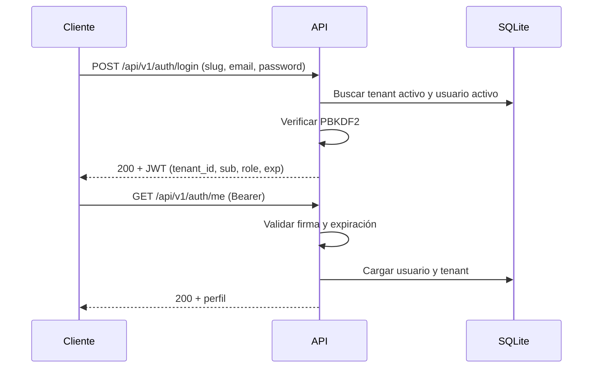

# Autenticación

Los usuarios pertenecen a un tenant y solo pueden autenticarse dentro de él. El login exige el slug del tenant, el correo y la contraseña.

## Iniciar sesión

```bash
curl -X POST http://127.0.0.1:8000/api/v1/auth/login \
  -H "Content-Type: application/json" \
  -d '{
    "tenant_slug": "acme",
    "email": "admin@acme.demo",
    "password": "DemoPass123"
  }'
```

Respuesta `200`:

```json
{
  "success": true,
  "code": "LOGIN_SUCCESS",
  "message": "Authenticated",
  "data": {
    "access_token": "eyJhbGciOiJIUzI1NiIsInR5cCI6IkpXVCJ9...",
    "token_type": "bearer",
    "expires_in": 3600,
    "user": {
      "id": "9a7b6c5d-4e3f-2a1b-0c9d-8e7f6a5b4c3d",
      "email": "admin@acme.demo",
      "full_name": "Demo Administrator",
      "role": "administrator",
      "is_active": true,
      "created_at": "2026-11-12T10:00:00Z"
    }
  },
  "correlation_id": "8f14e45f-ea0c-4b1f-9d5f-1c2a3b4c5d6e"
}
```

El mismo correo puede existir en tenants distintos; la pareja `tenant_slug` + `email` identifica al usuario.

## Usar el token

Todas las rutas protegidas esperan el token en la cabecera `Authorization`:

```bash
curl http://127.0.0.1:8000/api/v1/auth/me \
  -H "Authorization: Bearer $TOKEN"
```

Respuesta `200`:

```json
{
  "success": true,
  "code": "USER_PROFILE",
  "message": "OK",
  "data": {
    "id": "9a7b6c5d-4e3f-2a1b-0c9d-8e7f6a5b4c3d",
    "email": "admin@acme.demo",
    "full_name": "Demo Administrator",
    "role": "administrator",
    "is_active": true,
    "created_at": "2026-11-12T10:00:00Z"
  },
  "correlation_id": "8f14e45f-ea0c-4b1f-9d5f-1c2a3b4c5d6e"
}
```

## Claims del JWT

El token se firma con HS256 y contiene estos claims:

| Claim | Contenido |
| --- | --- |
| `sub` | UUID del usuario. |
| `tenant_id` | UUID del tenant al que pertenece el usuario. |
| `role` | `administrator` o `client`. |
| `email` | Correo del usuario. |
| `type` | Siempre `access`. |
| `iat` | Momento de emisión, en segundos Unix. |
| `exp` | Momento de expiración, en segundos Unix. |

La API valida firma, expiración y presencia de `sub`, `tenant_id`, `role` y `exp`. Después carga el usuario y el tenant desde la base y comprueba que ambos sigan activos. Un token válido de un usuario desactivado deja de funcionar.

## Roles

| Rol | Permisos |
| --- | --- |
| `administrator` | Registrar usuarios, abrir cuentas, cambiar estados de cuenta, modificar la configuración del tenant, consultar la auditoría y operar sobre cualquier cuenta del tenant. |
| `client` | Consultar y operar únicamente sobre sus propias cuentas. |

Un cliente que intenta leer un recurso de otro usuario del mismo tenant recibe `404 NOT_FOUND`. Un administrador de otro tenant también recibe `404` sobre recursos ajenos.

## Contraseñas

Las contraseñas se almacenan con PBKDF2-HMAC-SHA256, 260 000 iteraciones y una sal aleatoria por usuario. No se usa bcrypt, argon2 ni dependencias externas. Las contraseñas nunca se devuelven por la API ni se escriben en logs.

## Límites de peticiones

- El login está limitado por IP: `RATE_LIMIT_AUTH_PER_MINUTE`, 10 por minuto por defecto.
- Las operaciones financieras están limitadas por usuario y tenant: `RATE_LIMIT_FINANCIAL_PER_MINUTE`, 30 por minuto por defecto.
- Todas las rutas `/api/v1` tienen además un límite global por IP: `RATE_LIMIT_IP_PER_MINUTE`, 120 por minuto por defecto.

Cuando se supera un límite, la API responde `429 RATE_LIMIT_EXCEEDED` con la cabecera `Retry-After`.

## Flujo de autenticación



## Limitaciones actuales

- No hay refresh tokens ni revocación de sesiones: el token es válido hasta su expiración.
- No hay endpoint de cambio de contraseña.
- Los límites de peticiones viven en memoria y solo son correctos con un worker.
