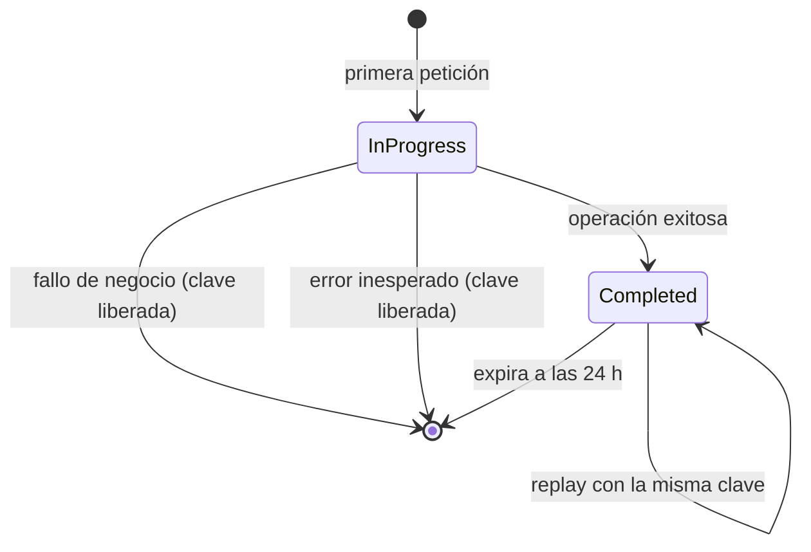

# Idempotencia

Todas las operaciones financieras mutables —depósitos, retiros y transferencias— exigen la cabecera `Idempotency-Key`. La clave permite reintentar una petición sin ejecutar dos veces el movimiento.

## Contrato

- La cabecera es obligatoria.
- Debe ser un UUID válido.
- Se normaliza a su representación canónica.
- Se asocia estrictamente a `tenant_id` + `user_id` + clave.
- Expira a las 24 horas.
- Se aplica a `POST /accounts/{id}/deposits`, `POST /accounts/{id}/withdrawals` y `POST /transfers`.

Si falta la cabecera:

```json
{
  "success": false,
  "code": "MISSING_IDEMPOTENCY_KEY",
  "message": "The Idempotency-Key header is required",
  "details": {"header": "Idempotency-Key"},
  "correlation_id": "8f14e45f-ea0c-4b1f-9d5f-1c2a3b4c5d6e"
}
```

Si no es un UUID:

```json
{
  "success": false,
  "code": "INVALID_IDEMPOTENCY_KEY",
  "message": "The Idempotency-Key header must be a UUID",
  "details": {"header": "Idempotency-Key"},
  "correlation_id": "8f14e45f-ea0c-4b1f-9d5f-1c2a3b4c5d6e"
}
```

Ambos casos responden `422`.

## Replay de una operación completada

Si la clave ya se procesó con éxito, la API devuelve exactamente el mismo cuerpo y el mismo código de estado original, sin volver a mover fondos. La respuesta incluye:

```http
X-Idempotent-Replayed: true
```

El cuerpo nuevo de la petición se ignora: se devuelve el cuerpo almacenado en la primera ejecución.

```bash
# Primera ejecución
curl -X POST http://127.0.0.1:8000/api/v1/transfers \
  -H "Authorization: Bearer $TOKEN" \
  -H "Idempotency-Key: 7d444840-9dc0-11d1-b245-5ffdce74fad2" \
  -H "Content-Type: application/json" \
  -d '{"source_account_id":"...","target_account_number":"731901614963","amount":"100.00"}'

# Reintento con la misma clave
curl -X POST http://127.0.0.1:8000/api/v1/transfers \
  -H "Authorization: Bearer $TOKEN" \
  -H "Idempotency-Key: 7d444840-9dc0-11d1-b245-5ffdce74fad2" \
  -H "Content-Type: application/json" \
  -d '{"source_account_id":"...","target_account_number":"731901614963","amount":"100.00"}'
```

La segunda respuesta tiene el mismo `data.id` y el mismo estado `201`.

## Operación en curso

Si otra petición con la misma clave está ejecutándose, la API responde inmediatamente:

```json
{
  "success": false,
  "code": "IDEMPOTENCY_IN_PROGRESS",
  "message": "A transaction with this Idempotency-Key is already in progress",
  "details": null,
  "correlation_id": "8f14e45f-ea0c-4b1f-9d5f-1c2a3b4c5d6e"
}
```

El código HTTP es `409 Conflict`. No se ejecuta el movimiento financiero.

## Fallo de negocio

Si la operación falla por una regla de negocio, por ejemplo por fondos insuficientes:

1. Se revierte el movimiento.
2. Se persiste una transacción con `status: "error"` y `error_code`.
3. Se elimina el registro de idempotencia para liberar la clave.
4. Se devuelve el error de negocio.

Después de corregir la causa —por ejemplo, depositando fondos— el reintento con la misma clave se ejecuta normalmente.

```json
{
  "success": false,
  "code": "INSUFFICIENT_FUNDS",
  "message": "The source account does not have enough funds to cover the amount and fee",
  "details": {
    "balance": "0.00",
    "amount": "100.00",
    "fee": "2.00",
    "required": "102.00",
    "currency": "USD"
  },
  "correlation_id": "8f14e45f-ea0c-4b1f-9d5f-1c2a3b4c5d6e"
}
```

## Fallo inesperado

Si ocurre un error no controlado, se revierte la transacción y se libera la clave para permitir un reintento. No se persiste una transacción `error` en ese caso.

## Diagrama de estados



## Persistencia y concurrencia

El registro de idempotencia se guarda en la tabla `idempotency_keys` con estado `in_progress` o `completed`, el código de respuesta y el cuerpo original. La unicidad de `tenant_id` + `user_id` + `key` la garantiza la base de datos. Además hay un lock en memoria por clave para serializar peticiones concurrentes dentro del proceso.

## Limitación con varios workers

El lock en memoria solo protege un proceso. La restricción única de la base sigue evitando duplicados, pero el comportamiento de concurrencia y los límites de peticiones están diseñados para **un worker**. Si se despliega con varios workers, hay que mover el lock y el rate limiting a un almacén compartido. Consulta [Despliegue](deployment.md).
