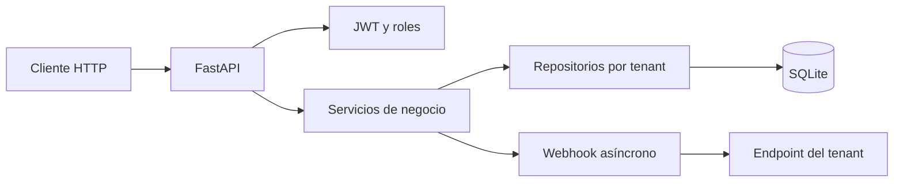

# BankOS

BankOS es una plataforma bancaria multi-tenant como servicio. Cada institución financiera opera como un tenant independiente con sus propios usuarios, cuentas, divisas, comisiones, tasas de cambio, reglas de negocio y registros de auditoría.

Este repositorio contiene **solo el backend**: una API REST construida con FastAPI, SQLAlchemy y SQLite. El frontend y la aplicación móvil se desarrollan por separado y no forman parte de este proyecto.

## Capacidades principales

- Aislamiento estricto por tenant: el `tenant_id` viaja en el JWT y todos los repositorios filtran por él.
- Roles `administrator` y `client` con permisos diferenciados.
- Cuentas bancarias con borrado lógico y bloqueo de operaciones sobre cuentas inactivas.
- Depósitos, retiros y transferencias internas con comisión configurable.
- Transferencias multimoneda con tabla estática de tasas por tenant.
- Idempotencia obligatoria en todas las operaciones financieras mutables.
- Historial paginado de transacciones con filtros.
- Auditoría inmutable de acciones administrativas.
- Webhooks asíncronos para transferencias recibidas.
- Respuestas estandarizadas, versionado `/api/v1` y trazabilidad con `X-Correlation-ID`.

## Arquitectura de alto nivel

## Por dónde empezar

| Si quieres | Lee |
| --- | --- |
| Ejecutar BankOS en tu máquina | [Primeros pasos](getting-started.md) |
| Conocer las variables de entorno y la configuración por tenant | [Configuración](configuration.md) |
| Entender el login, los tokens y los roles | [Autenticación](authentication.md) |
| Ver cómo se aísla cada institución | [Multi-tenencia](multi-tenancy.md) |
| Gestionar cuentas bancarias | [Cuentas](accounts.md) |
| Operar depósitos, retiros e historial | [Operaciones](operations.md) |
| Entender el contrato de idempotencia | [Idempotencia](idempotency.md) |
| Calcular comisiones y conversiones | [Transferencias y tasas](transfers.md) |
| Revisar el registro de auditoría | [Auditoría](audit.md) |
| Configurar notificaciones HTTP | [Webhooks](webhooks.md) |
| Consultar códigos y sobres de error | [Errores](errors.md) |
| Desplegar con Docker | [Despliegue](deployment.md) |

## Documentación en inglés

La documentación también está disponible en inglés. Cambia el idioma con el selector de la cabecera, que alterna entre Español y English sin salir del sitio.
