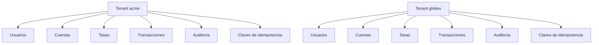

# Multi-tenencia

BankOS es una plataforma multi-tenant: cada institución financiera es un tenant con datos y configuración independientes. El aislamiento es lógico y se aplica en la capa de repositorios.

## Registro de un tenant

El registro es público. Crea el tenant y su primer administrador en una sola transacción.

```bash
curl -X POST http://127.0.0.1:8000/api/v1/tenants \
  -H "Content-Type: application/json" \
  -d '{
    "name": "Acme Demo Bank",
    "slug": "acme",
    "admin_email": "admin@acme.demo",
    "admin_full_name": "Demo Administrator",
    "admin_password": "DemoPass123",
    "base_currency": "USD",
    "max_transaction_amount": "1000000.00",
    "commission_type": "percentage",
    "commission_value": "2"
  }'
```

Respuesta `201`:

```json
{
  "success": true,
  "code": "TENANT_REGISTERED",
  "message": "Tenant created",
  "data": {
    "tenant": {
      "id": "4f3f0f0e-6d1a-4b5e-9f4e-2f5a1c7d8e90",
      "name": "Acme Demo Bank",
      "slug": "acme",
      "base_currency": "USD",
      "max_transaction_amount": "1000000.00",
      "commission_type": "percentage",
      "commission_value": "2.000000",
      "webhook_url": null,
      "is_active": true,
      "created_at": "2026-11-12T10:00:00Z"
    },
    "admin": {
      "id": "9a7b6c5d-4e3f-2a1b-0c9d-8e7f6a5b4c3d",
      "email": "admin@acme.demo",
      "full_name": "Demo Administrator",
      "role": "administrator",
      "is_active": true,
      "created_at": "2026-11-12T10:00:00Z"
    }
  },
  "correlation_id": "8f14e45f-ea0c-4b1f-9d5f-1c2a3b4c5d6e"
}
```

El registro no devuelve un token. Después de crear el tenant hay que iniciar sesión con `POST /api/v1/auth/login`.

### Reglas del slug

- Entre 3 y 60 caracteres.
- Solo minúsculas, dígitos y guiones.
- Debe empezar y terminar con letra o dígito.
- Es único en toda la plataforma.
- Si ya existe, la API responde `409 TENANT_SLUG_TAKEN`.

## Modelo de aislamiento



Todas las tablas de negocio tienen `tenant_id`. Los repositorios reciben el `tenant_id` del principal autenticado y lo aplican en cada consulta. No existe una ruta que acepte un `tenant_id` arbitrario del cliente.

Consecuencias:

- Un recurso de otro tenant se comporta como inexistente: `404 NOT_FOUND`.
- Un administrador no puede leer ni operar sobre recursos de otro tenant.
- Un cliente solo ve sus propias cuentas y transacciones.
- Las claves de idempotencia se asocian a `tenant_id` + `user_id` + clave.
- La auditoría se consulta únicamente dentro del tenant del token.

## Roles dentro del tenant

| Rol | Alcance |
| --- | --- |
| `administrator` | Gestiona usuarios, cuentas, configuración, tasas, auditoría y operaciones de cualquier cuenta del tenant. |
| `client` | Solo consulta y opera sus propias cuentas. |

Los usuarios se crean con `POST /api/v1/users`. Un cliente no puede listar usuarios ni abrir cuentas.

## Aislamiento físico

El aislamiento es lógico: todos los tenants comparten la misma base SQLite y el mismo esquema. No hay una base de datos física por tenant. Esto es suficiente para el alcance del proyecto, pero una separación física requeriría una base por tenant o un motor con aislamiento por filas y políticas adicionales.

## Registro de auditoría del alta

El alta de un tenant genera dos entradas de auditoría dentro del nuevo tenant:

- `tenant.created`
- `user.created` para el administrador inicial

Las altas posteriores de usuarios, cuentas y cambios de configuración también se registran. Consulta [Auditoría](audit.md).
