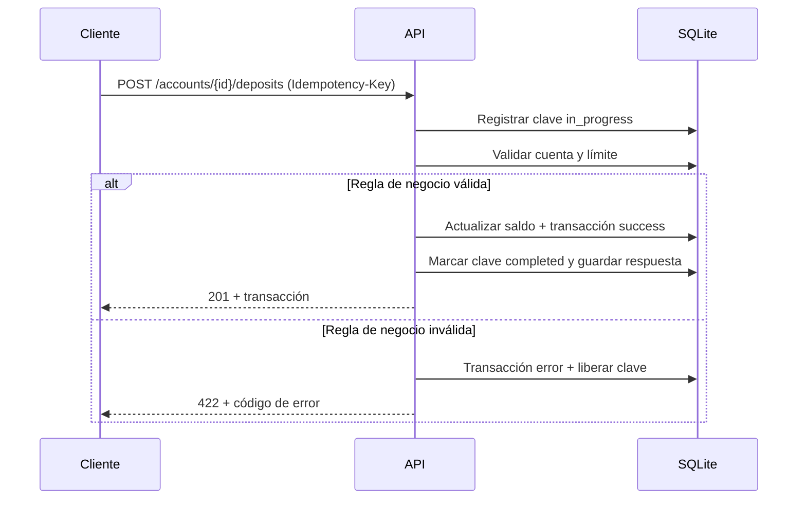

# Operaciones

Los depósitos y retiros son operaciones mutables y exigen `Idempotency-Key`. Se ejecutan sobre una cuenta visible para el llamante y quedan registrados como transacciones.

## Depósito

```bash
curl -X POST http://127.0.0.1:8000/api/v1/accounts/$ACCOUNT_ID/deposits \
  -H "Authorization: Bearer $TOKEN" \
  -H "Idempotency-Key: 7d444840-9dc0-11d1-b245-5ffdce74fad2" \
  -H "Content-Type: application/json" \
  -d '{
    "amount": "1000.00",
    "description": "Initial funding"
  }'
```

Respuesta `201`:

```json
{
  "success": true,
  "code": "DEPOSIT_COMPLETED",
  "message": "Deposit completed",
  "data": {
    "id": "0f1e2d3c-4b5a-6978-8796-a5b4c3d2e1f0",
    "type": "deposit",
    "status": "success",
    "source_account_number": null,
    "target_account_number": "731901614963",
    "amount": "1000.00",
    "currency": "USD",
    "converted_amount": "1000.00",
    "target_currency": "USD",
    "exchange_rate": "1.000000",
    "fee": "0.00",
    "description": "Initial funding",
    "idempotency_key": "7d444840-9dc0-11d1-b245-5ffdce74fad2",
    "error_code": null,
    "created_at": "2026-11-12T10:10:00Z"
  },
  "correlation_id": "8f14e45f-ea0c-4b1f-9d5f-1c2a3b4c5d6e"
}
```

Reglas:

- La cuenta debe estar `active`.
- El importe debe ser estrictamente positivo y tener como máximo 2 decimales.
- El importe no puede superar `max_transaction_amount` del tenant.
- Un administrador puede depositar en cualquier cuenta del tenant; un cliente solo en las suyas.
- No se aplica comisión a los depósitos.

## Retiro

```bash
curl -X POST http://127.0.0.1:8000/api/v1/accounts/$ACCOUNT_ID/withdrawals \
  -H "Authorization: Bearer $TOKEN" \
  -H "Idempotency-Key: 9b2d3e4f-5a6b-7c8d-9e0f-1a2b3c4d5e6f" \
  -H "Content-Type: application/json" \
  -d '{
    "amount": "50.00",
    "description": "Cash withdrawal"
  }'
```

La respuesta usa el código `WITHDRAWAL_COMPLETED` y el mismo esquema de transacción.

Reglas adicionales:

- El saldo debe alcanzar el importe solicitado.
- Si no alcanza, la API responde `422 INSUFFICIENT_FUNDS`.
- No se aplica comisión a los retiros.

## Historial de transacciones

```bash
curl "http://127.0.0.1:8000/api/v1/transactions?limit=20&offset=0&type=transfer&status=success" \
  -H "Authorization: Bearer $TOKEN"
```

Filtros:

| Parámetro | Valores | Descripción |
| --- | --- | --- |
| `limit` | 1–100 | Elementos por página. Por defecto 50. |
| `offset` | ≥ 0 | Elementos a omitir. |
| `type` | `deposit`, `withdrawal`, `transfer` | Tipo de operación. |
| `status` | `success`, `error` | Resultado de la operación. |
| `account_id` | UUID | Cuenta de origen o destino. |
| `date_from` | ISO 8601 | Límite inferior inclusivo. |
| `date_to` | ISO 8601 | Límite superior inclusivo. |

Un administrador ve todo el historial del tenant. Un cliente solo ve las transacciones en las que participa alguna de sus cuentas.

Respuesta:

```json
{
  "success": true,
  "code": "TRANSACTION_LIST",
  "message": "OK",
  "data": {
    "items": [
      {
        "id": "0f1e2d3c-4b5a-6978-8796-a5b4c3d2e1f0",
        "type": "deposit",
        "status": "success",
        "source_account_number": null,
        "target_account_number": "731901614963",
        "amount": "1000.00",
        "currency": "USD",
        "converted_amount": "1000.00",
        "target_currency": "USD",
        "exchange_rate": "1.000000",
        "fee": "0.00",
        "description": "Initial funding",
        "idempotency_key": "7d444840-9dc0-11d1-b245-5ffdce74fad2",
        "error_code": null,
        "created_at": "2026-11-12T10:10:00Z"
      }
    ],
    "total": 1,
    "limit": 20,
    "offset": 0
  },
  "correlation_id": "8f14e45f-ea0c-4b1f-9d5f-1c2a3b4c5d6e"
}
```

## Leer una transacción

```bash
curl http://127.0.0.1:8000/api/v1/transactions/$TRANSACTION_ID \
  -H "Authorization: Bearer $TOKEN"
```

El cliente solo puede leer transacciones de sus cuentas. Una transacción ajena responde `404 NOT_FOUND`.

## Transacciones fallidas

Cuando una operación falla por una regla de negocio, la API persiste una transacción con `status: "error"` y el código en `error_code`, por ejemplo `INSUFFICIENT_FUNDS`. El intento fallido aparece en el historial con `type` y `idempotency_key`, pero no mueve saldos. La clave de idempotencia se libera para permitir el reintento. Consulta [Idempotencia](idempotency.md).

## Flujo de una operación


