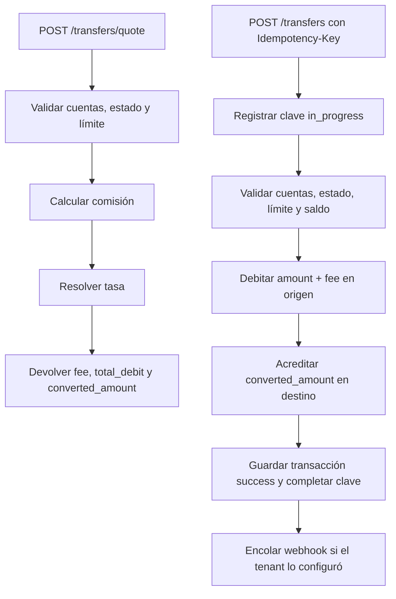

# Transferencias y tasas

Una transferencia mueve fondos entre dos cuentas del mismo tenant. Puede ser en la misma moneda o entre monedas distintas usando la tabla estática de tasas del tenant. La comisión se cobra en la moneda de origen.

## Cotizar una transferencia

`POST /api/v1/transfers/quote` calcula comisión, tasa y montos sin mover fondos. No requiere `Idempotency-Key`.

```bash
curl -X POST http://127.0.0.1:8000/api/v1/transfers/quote \
  -H "Authorization: Bearer $TOKEN" \
  -H "Content-Type: application/json" \
  -d '{
    "source_account_id": "5d4c3b2a-1f0e-9d8c-7b6a-5f4e3d2c1b0a",
    "target_account_number": "838433939096",
    "amount": "100.00"
  }'
```

Respuesta `200`:

```json
{
  "success": true,
  "code": "TRANSFER_QUOTE",
  "message": "Transfer quoted",
  "data": {
    "amount": "100.00",
    "fee": "2.00",
    "total_debit": "102.00",
    "exchange_rate": "0.900000",
    "converted_amount": "90.00",
    "source_currency": "USD",
    "target_currency": "EUR"
  },
  "correlation_id": "8f14e45f-ea0c-4b1f-9d5f-1c2a3b4c5d6e"
}
```

La cotización valida que ambas cuentas existan y estén activas, que sean distintas y que el importe no supere el límite del tenant. **No comprueba el saldo disponible**; eso se valida al ejecutar la transferencia.

## Ejecutar una transferencia

```bash
curl -X POST http://127.0.0.1:8000/api/v1/transfers \
  -H "Authorization: Bearer $TOKEN" \
  -H "Idempotency-Key: 7d444840-9dc0-11d1-b245-5ffdce74fad2" \
  -H "Content-Type: application/json" \
  -d '{
    "source_account_id": "5d4c3b2a-1f0e-9d8c-7b6a-5f4e3d2c1b0a",
    "target_account_number": "838433939096",
    "amount": "100.00",
    "description": "Monthly transfer"
  }'
```

Respuesta `201`:

```json
{
  "success": true,
  "code": "TRANSFER_COMPLETED",
  "message": "Transfer completed",
  "data": {
    "id": "1a2b3c4d-5e6f-7a8b-9c0d-1e2f3a4b5c6d",
    "type": "transfer",
    "status": "success",
    "source_account_number": "731901614963",
    "target_account_number": "838433939096",
    "amount": "100.00",
    "currency": "USD",
    "converted_amount": "90.00",
    "target_currency": "EUR",
    "exchange_rate": "0.900000",
    "fee": "2.00",
    "description": "Monthly transfer",
    "idempotency_key": "7d444840-9dc0-11d1-b245-5ffdce74fad2",
    "error_code": null,
    "created_at": "2026-11-12T10:20:00Z"
  },
  "correlation_id": "8f14e45f-ea0c-4b1f-9d5f-1c2a3b4c5d6e"
}
```

Reglas:

- Origen y destino deben existir en el mismo tenant.
- Ambas cuentas deben estar `active`.
- No se puede transferir a la misma cuenta.
- El origen debe tener saldo suficiente para el importe **más la comisión**.
- El importe no puede superar `max_transaction_amount`.
- El destino se identifica por `account_number`, no por UUID.
- Un cliente solo puede usar como origen una cuenta propia; un administrador puede usar cualquier cuenta del tenant.

## Comisión

La comisión se calcula sobre el importe enviado, en la moneda de origen:

| Tipo | Fórmula |
| --- | --- |
| `percentage` | `fee = round(amount × commission_value / 100, 2)` |
| `fixed` | `fee = commission_value` |

El débito total del origen es `amount + fee`. La conversión se aplica al importe enviado, **no a la comisión**. El destino recibe `round(amount × exchange_rate, 2)`.

Ejemplo con comisión porcentual 2 %:

- Importe: `100.00 USD`
- Comisión: `2.00 USD`
- Débito total: `102.00 USD`
- Tasa USD→EUR: `0.900000`
- Acreditado en destino: `90.00 EUR`

## Tasas de cambio

La tabla de tasas es estática y pertenece al tenant. Se reemplaza completa con `PUT /api/v1/tenants/me/exchange-rates`.

```bash
curl -X PUT http://127.0.0.1:8000/api/v1/tenants/me/exchange-rates \
  -H "Authorization: Bearer $ADMIN_TOKEN" \
  -H "Content-Type: application/json" \
  -d '{
    "rates": [
      {"source_currency": "USD", "target_currency": "EUR", "rate": "0.900000"},
      {"source_currency": "EUR", "target_currency": "USD", "rate": "1.100000"}
    ]
  }'
```

Resolución de una tasa:

1. Si origen y destino tienen la misma moneda, se usa `1.000000`.
2. Si existe la tasa directa `origen → destino`, se usa.
3. Si no existe, se usa la inversa `1 / tasa(destino → origen)`, redondeada a 6 decimales.
4. Si no hay ninguna, la API responde `422 EXCHANGE_RATE_NOT_FOUND`.

Las tasas se almacenan con 6 decimales. Los importes se redondean a 2 decimales con `ROUND_HALF_UP`.

## Límite por operación

`max_transaction_amount` se valida contra el importe en la moneda de la operación. Si se supera, la API responde `422 TRANSACTION_LIMIT_EXCEEDED` antes de mover fondos.

## Errores frecuentes

| Código | HTTP | Causa |
| --- | --- | --- |
| `INSUFFICIENT_FUNDS` | 422 | El origen no cubre importe + comisión. |
| `ACCOUNT_NOT_ACTIVE` | 422 | Origen o destino no está activo. |
| `SAME_ACCOUNT_TRANSFER` | 422 | Origen y destino son la misma cuenta. |
| `EXCHANGE_RATE_NOT_FOUND` | 422 | No hay tasa directa ni inversa. |
| `TRANSACTION_LIMIT_EXCEEDED` | 422 | El importe supera el límite del tenant. |
| `NOT_FOUND` | 404 | La cuenta de origen o el número de destino no existe en el tenant. |

## Flujo de una transferencia


